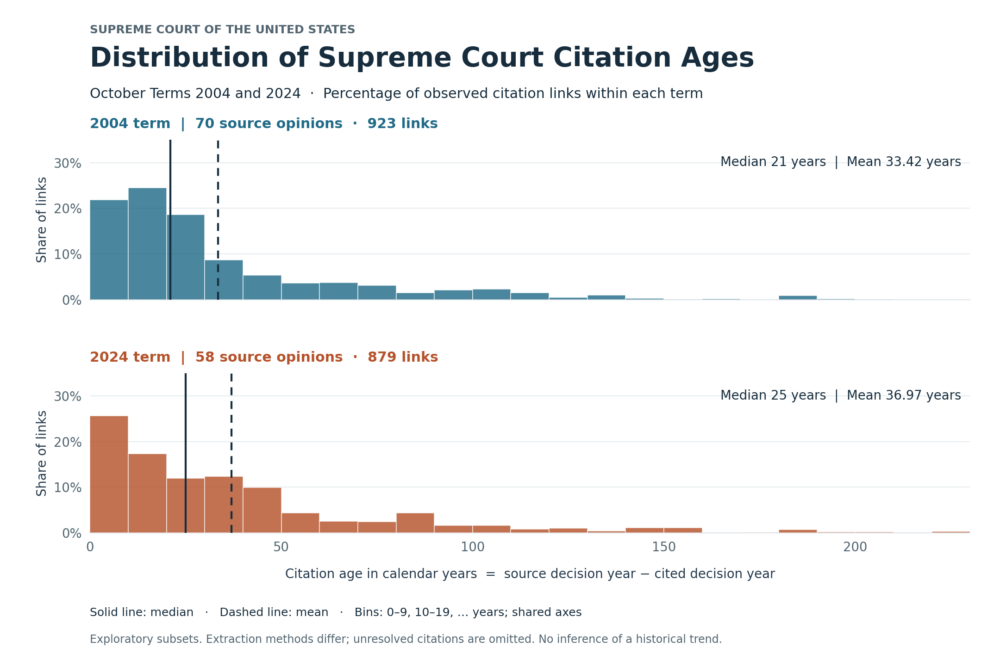

# Supreme Court Citation Network Analysis

An exploratory Python analysis of citation patterns in selected majority and per-curiam opinions from October Term 2004 and the consecutive October terms 2020–2024. Cases are represented as nodes; a directed edge connects a source case to a Supreme Court case it cites. Each distinct case pair counts once.

The current datasets contain **349 source opinions and 5,164 citation links across six terms**. The 2020–2023 expansion is preliminary, with automated structural and boundary checks and targeted evidence checks; it has not received complete manual citation audits. The comparison describes the collected data. Differences in extraction methods and coverage prevent interpreting the results as an established historical trend.

## Annual coverage and results

| October term | Included / eligible source cases | Citation links | Mean links per source | Mean of opinion mean ages (years) |
| --- | ---: | ---: | ---: | ---: |
| 2004 | 70 / 75 | 923 | 13.19 | 29.98 |
| 2020 | 52 / 54 | 685 | 13.17 | 32.40 |
| 2021 | 60 / 61 | 1,004 | 16.73 | 30.93 |
| 2022 | 52 / 56 | 890 | 17.12 | 34.89 |
| 2023 | 57 / 58 | 783 | 13.74 | 34.16 |
| 2024 | 58 / 59 | 879 | 15.16 | 32.33 |

Eligibility means an oral argument is recorded and SCDB decision type is 1 or 6. It is not the full Court docket. Age means exclude zero-link sources; citation-count means include them. New terms retain evidence for every edge and record held opinions and unresolved references.

The equal-opinion mean age fluctuates across 2020–2024; the additional observations do not support describing the original two-term increase as a steady annual pattern. These descriptive results do not control for issue composition, missing references, or extraction differences.

[Read the live annual summary](https://aceandersonpersonal.github.io/scotus-citation-analysis/annual_summary.html), including within-opinion age bands and the overlap of cited precedents between consecutive terms. Download the [term summaries](reports/annual_summary.csv) or [all opinion measurements](reports/annual_opinion_metrics.csv).

```bash
python3 annual_summary.py
```

The analysis discovers published `data/term_YYYY/` folders. Staged acquisition data do not appear in the website until promoted. The four new terms use a common parser; 2004 and 2024 retain their original extraction methods and datasets.

## Original 2004–2024 comparison

| Term | Source opinions | Citation links | Mean links per source | Mean citation age | Median citation age |
| --- | ---: | ---: | ---: | ---: | ---: |
| 2004 | 70 | 923 | 13.19 | 33.42 years | 21 years |
| 2024 | 58 | 879 | 15.16 | 36.97 years | 25 years |

Within these collected subsets, the 2024 opinions cite **1.97 more distinct cases per source** on average. The median citation age is **four years higher**, and the mean citation age is **3.56 years higher**. These are differences between the two datasets, not estimates of a Court-wide historical change. Citation ages are measured per link, so opinions with more cited cases contribute more observations.



The [standalone report](reports/citation_age_report.html) includes the distribution chart, leading-precedent tables, citation concentration, definitions, coverage notes, and reproduction instructions. Open the downloaded HTML file in a browser to view it; GitHub may display its source instead.

The ten most cited precedents receive **3.4% of links in 2004** and **4.0% in 2024**. Woodford v. Garceau leads the 2004 subset (4 of 70 source cases, 5.7%); Loper Bright Enterprises v. Raimondo leads the 2024 subset (6 of 58, 10.3%). These are descriptive findings within the collected datasets.

The report shows every precedent tied at the tenth position: 14 rows for 2004 and 17 for 2024. The [rankings CSV](reports/cited_precedent_rankings.csv) contains the same cases, ranks, counts, and source-case shares (stored as proportions). Table percentages divide by source cases, including zero-citation sources; concentration divides by citation links and uses exactly ten precedents even when the table includes extra ties.

## Opinion-level comparison

The original age summary treats every citation link as an observation. An opinion with 40 cited cases contributes ten times as many observations as one with four. `compare_terms.py` complements that result by calculating a mean citation age for each source opinion, then giving those opinion means equal weight.

| Mean citation age | 2004 | 2024 | Difference (2024 − 2004) |
| --- | ---: | ---: | ---: |
| Equal weight per citation link | 33.42 years | 36.97 years | +3.56 years |
| Equal weight per opinion with links | 29.98 years | 32.33 years | +2.35 years |

Differences are calculated before rounding. The opinion-level calculation includes 70 opinions in 2004 and 55 in 2024. The three zero-link 2024 opinions have no defined citation age; they remain included in citation-count statistics.

Removing one opinion at a time from either term leaves an equal-opinion difference of **+1.46 to +2.93 years** across 125 removals. Removing *Trump v. CASA, Inc.* has the largest absolute effect, reducing the gap from 2.35 to 1.46 years. The positive difference is therefore not attributable to any single included opinion. This check does not address several influential opinions together, omitted cases, missing citations, extraction differences, or issue composition. The range is **not a confidence interval**.

```bash
python3 compare_terms.py
```

This standard-library command generates the [opinion-level report](reports/opinion_comparison.html), [metrics for every source opinion](reports/opinion_metrics.csv), [all single-opinion omission results](reports/opinion_omission_effects.csv), and a [JSON summary with input fingerprints](reports/opinion_comparison.json). Download the HTML report together with the CSV and JSON files to use its relative download links. Other curated term pairs can be selected with `--terms EARLIER LATER`.

## Run the analysis

Python 3.12 is recommended for the complete project. The standard-library analysis alone supports Python 3.9 or later; the pinned PDF extraction dependencies require Python 3.10 or later. Run these commands from this folder:

```bash
python3 start.py
```

The analysis uses Python's standard library and the curated CSVs under each `data/term_YYYY/` folder. It requires no API token or network connection.

To generate the report, set up the plotting environment once:

```bash
python3.12 -m venv .venv
source .venv/bin/activate
python3 -m pip install -r requirements-report.txt
python3 make_report.py
```

If `.venv` is already set up, activate it and run the last command. Alternatively, use `.venv/bin/python make_report.py` without activation. These activation instructions are for macOS/Linux.

## Case explorer

[Open the live explorer](https://aceandersonpersonal.github.io/scotus-citation-analysis/).

The browser interface lets you select a term and source case, search cited precedents, sort by age, and open the underlying opinions. Its Python exporter reuses the project's adjacency lists and metadata; no API token or server database is required.

```bash
python3 scripts/build_explorer.py
python3 -m http.server 8000 --directory web/dist
```

Open `http://localhost:8000` in a browser. Use an HTTP server rather than opening `index.html` directly, because the interface fetches its local JSON dataset. Stop the server with Ctrl+C. Source files are in `web/`; generated output is ignored by Git. The [live explorer](https://aceandersonpersonal.github.io/scotus-citation-analysis/) is hosted on GitHub Pages and publicly accessible without signing in.

The explorer automatically discovers `data/term_YYYY/` folders and checks their manifests before export. The Annual Summary covers every published term. The original comparative report remains focused on 2004 and 2024. See [the term expansion guide](data/README.md) for the dataset contract and review process.

## VS Code setup

Open this project folder and select **Python: Select Interpreter → .venv/bin/python** from the Command Palette. The status bar should show the project's `.venv` environment. Workspace settings provide the default interpreter, scan all project files for diagnostics, and enable the unittest test runner.

After changing the interpreter, open a new terminal so it activates the selected environment. If activation is uncertain, use `.venv/bin/python` explicitly. A missing-import warning usually means the selected interpreter does not contain that dependency; installing a package in a different Python will not resolve it.

To work on PDF extraction, install its additional dependencies in the same environment:

```bash
.venv/bin/python -m pip install -r requirements-data.txt
```

## Run the tests

```bash
python3 -m unittest discover -s tests -v
```

Tests cover directed paths, graph traversal with cycles, incoming citation counts, zero-citation source cases, citation ages, CSV reading, and duplicate-edge handling. Explorer tests also cover additional term discovery, partial dates, zero-link cases, inconsistent manifests, unknown case IDs, and invalid opinion links. Comparison tests verify the distinction between opinion and link weighting, omission arithmetic, undefined ages, and consistency with the original summaries. Dataset checks verify IDs across all terms, chronology, source flags, manifest counts, and evidence for every included edge. Acquisition regressions cover multi-case PDF volumes, split printed-page headers, separate-opinion boundaries, and ambiguous unpaginated citations. Annual tests verify age-band weighting and cited-precedent overlap.

The [GitHub Actions workflow](.github/workflows/checks.yml) runs these tests, the analysis, both report builds, and an explorer export on pushes and pull requests. It uses only the committed curated data; no API credentials or raw caches are required. Successful pushes to `codex/initial-release` also publish the exported site to GitHub Pages. Pull requests run checks without publishing. The deployment uploads only the generated website directory.

## Folder structure

```text
SCOTUS Project/
    .github/workflows/          Automated tests and report build
    start.py                    Graph functions and term summaries
    compare_terms.py            Opinion-level weighting and sensitivity analysis
    annual_summary.py           Annual metrics, age composition, and precedent overlap
    make_report.py              Chart and HTML report generation
    requirements-report.txt     Plotting dependency
    requirements-data.txt       Optional PDF extraction dependencies
    web/                        Case explorer HTML, CSS, and JavaScript
    scripts/                    Data acquisition, rebuilding, validation, and explorer export
    tests/                      Automated analysis tests
    practice/                   Original learning exercises and toy CSV
    data/
        term_2004/              Active 2004 data, metadata, and audits
        term_2020/ … term_2023/ Preliminary expanded datasets and check records
        term_2024/              Active 2024 data, metadata, and audits
        staging/                Ignored acquisition and draft exports
        reference_cache/        Ignored additional reporter metadata
        sample_3_cases/         Earlier CourtListener sample
        raw/                    Local sample API-response cache
        sample_manifest.json    Historical sample provenance
        archive/                Preserved legacy root CSV copies
    reports/                    Generated chart, report, and summary JSON
```

Start with `main()` in `start.py`, then follow `summarize_term()` and `load_term()`. The report generator imports those analysis functions; it does not maintain a separate implementation of the metrics.

The hidden `.venv/` directory contains the local Python environment. The private `.courtlistener-token` remains at the project root. Both are ignored by Git, along with raw acquisition caches, archived duplicate CSVs, Python caches, and macOS metadata.

## Definitions and limitations

Citation age is the source decision year minus the cited decision year, measured once per binary edge. Some older archive records provide only a year or month; those partial dates are preserved, and the age calculation uses their recorded year. A precedent cited by five source cases contributes five observations. Repeated mentions within one source contribute one observation. Zero-citation sources count toward the average links per source but contribute no citation ages.

The 2004 data uses Harvard archive citation links attached to opinion blocks. The 2024 data uses official Supreme Court PDF text with resolved case metadata. Five additional 2004 source cases and one 2024 source case remain held for review. Eight eligible sources are held across the four new terms: seven extraction/section cases and one unavailable official PDF. The new collector handles report parts containing multiple cases and transformed PDF fonts, and resolves blank-page citations only when a full case name and reporter volume match uniquely. A verified date discrepancy for Mississippi v. Tennessee is recorded in `data/source_overrides.json`. Unresolved and ambiguous references are omitted and logged. The selected opinion audits do not establish complete extraction recall.

The 2024 source set includes three argued per-curiam dismissals with no citation links. Term labels are not calendar years; the 2024 term includes decisions issued in 2025. A citation does not establish agreement with a precedent or its legal importance.

The per-term `manifest.json`, `case_review.csv`, `citation_review.csv`, and audit records document the selection and known issues. The generated `reports/citation_age_summary.json` records chart bin counts and input fingerprints.

## Data preparation

See [the scripts guide](scripts/README.md) for the acquisition and rebuilding commands. These are separate from running the analysis. A fresh clone can reproduce the analysis and report from the included curated data. Rebuilding those datasets from source records is a separate workflow: it requires local raw caches that are not included in this repository. PDF extraction also requires the dependencies in `requirements-data.txt`. The acquisition scripts do not yet recreate the complete metadata cache from scratch.

The earlier exercises remain runnable with:

```bash
python3 practice/practice.py
python3 practice/graph.py
```

## Planned development

The current version provides six term datasets, graph analysis, annual and pairwise summaries, a case explorer, and recorded checks. The entire 21st century is not yet covered. Further work is planned:

- Apply a common extraction method and expand citation audits before interpreting differences between terms.
- Compare citation ages and patterns within similar case categories.
- Investigate citation frequency and context beyond binary links.
- Extend the explorer with citation evidence and additional terms after acquisition and validation.

## Sources

- [Supreme Court Database release 2025 01](https://scdb.la.psu.edu/data/2025-release-01/)
- [Harvard Caselaw Access Project archive](https://static.case.law/)
- [Supreme Court opinions for the 2024 term](https://www.supremecourt.gov/opinions/slipopinion/24)
- [CourtListener](https://www.courtlistener.com/) for the initial sample and selected case-identity metadata
